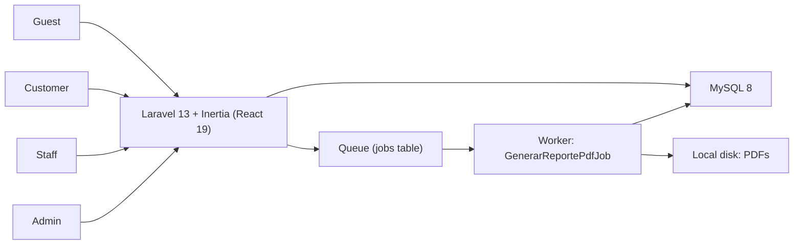
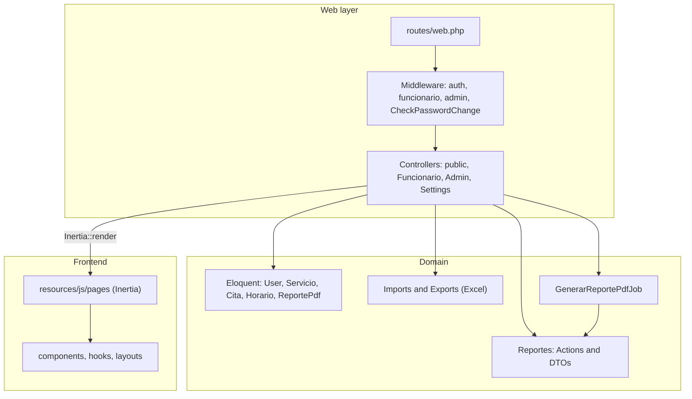
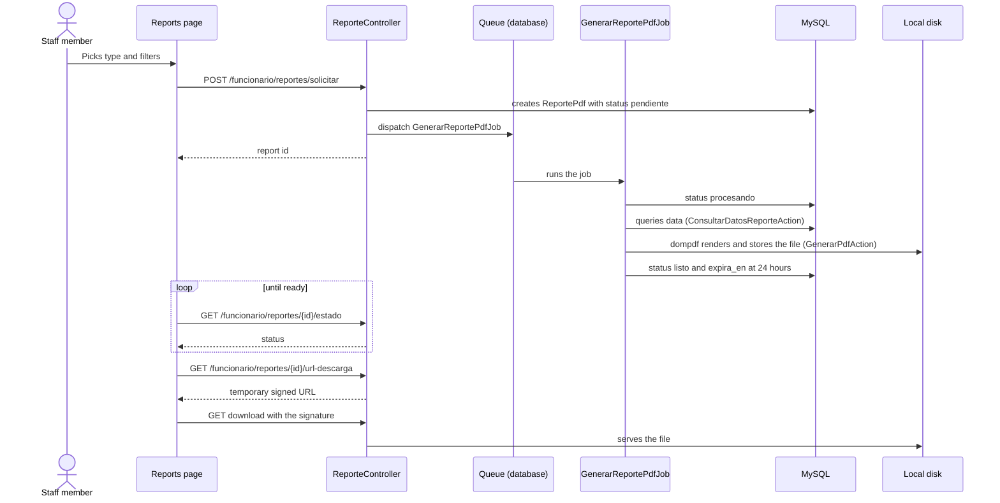

# AppSalon architecture

English · [Español](./architecture.md)

Laravel monolith with Inertia: controllers return React pages instead of JSON, so there is no separate REST API. Heavy work (PDF) leaves the HTTP request and runs on a database-backed queue.

## Context



## Components



## Main flow: asynchronous PDF report



If the job fails, `failed()` stores `estado = error` and the message. The job retries once (`tries = 2`, `backoff = 10`, `timeout = 120`). The scheduled command `reportes:limpiar-expirados` runs daily.

## Other flows

- **Guest booking:** `ReservaPublicaController` checks occupied slots, creates the appointment with a `token_seguimiento`, and the guest follows its status at `/reservar/estado/{token}`.
- **Excel import:** `preview` reads the file and returns rows with errors, `revalidate` re-validates rows corrected on screen, and `import-rows` saves only the valid ones. It applies to appointments (staff) and services (admin).

## Folder structure

```text
app/
  Actions/Fortify/         user registration
  Http/Controllers/        root (Cita, ReservaPublica, Dashboard, Home), Admin/, Funcionario/, Settings/
  Http/Middleware/         Admin, Funcionario, CheckPasswordChange, HandleInertiaRequests
  Reportes/                Actions (ConsultarDatos, GenerarPdf) and DTOs
  Jobs/ Imports/ Exports/ Models/
resources/js/pages/        admin, agenda, auth, citas, reportes, reservar, settings
database/migrations/       Spanish table names: usuarios, servicios, citas, citasServicios, horarios, reportes_pdf
```

## Key decisions

- **Inertia instead of API plus SPA.** One application, with no duplicated validation or authentication. Wayfinder generates typed routes for the frontend.
- **Roles through middleware.** `admin` and `funcionario` guard route groups; the staff group includes the admin. `CheckPasswordChange` forces a password change when needed.
- **PDF outside the request.** Rendering with dompdf can be slow, so it is queued and the client polls the status. Files expire after 24 hours and downloads use signed URLs.
- **Action and DTO for reports.** `ConsultarDatosReporteAction`, `GenerarPdfAction` and `FiltroPdfDTO` separate querying, rendering and filters, and can be tested without HTTP.
- **Three-step import.** Preview, revalidate and import keep a partly invalid file from aborting everything.
- **FULLTEXT search on MySQL only.** The index migration runs only with the `mysql` driver, so tests run on SQLite.
- **Queue and cache in the database.** No Redis: `QUEUE_CONNECTION=database` and `CACHE_STORE=database`.

## Pending

- There are traces of broadcasting setup (`routes/channels.php`, `pusher-js`), but `laravel/reverb` is not installed: the app does not use realtime.
