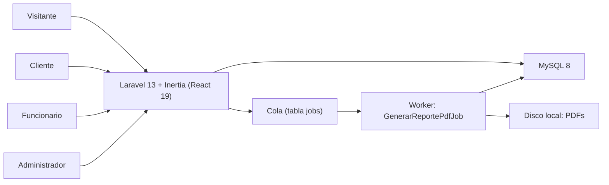
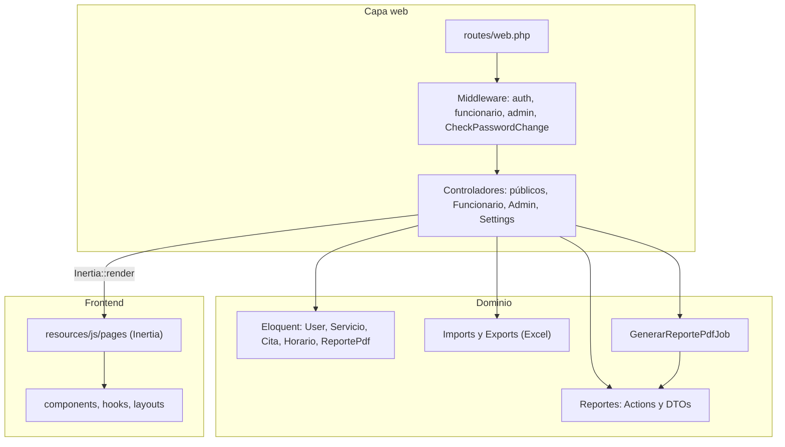
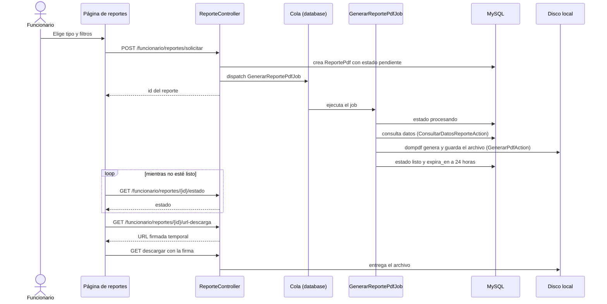

# Arquitectura de AppSalon

[English](./architecture.en.md) · Español

Monolito Laravel con Inertia: los controladores devuelven páginas React en lugar de JSON, así que no hay API REST separada. El trabajo pesado (PDF) sale de la petición HTTP y corre en una cola respaldada por la base de datos.

## Contexto



## Componentes



## Flujo principal: reporte PDF asíncrono



Si el job falla, `failed()` guarda `estado = error` y el mensaje. El job reintenta una vez (`tries = 2`, `backoff = 10`, `timeout = 120`). El comando programado `reportes:limpiar-expirados` corre a diario.

## Otros flujos

- **Reserva pública:** `ReservaPublicaController` valida los horarios ocupados, crea la cita con un `token_seguimiento` y el visitante consulta su estado en `/reservar/estado/{token}`.
- **Importación de Excel:** `preview` lee el archivo y devuelve filas con errores, `revalidate` vuelve a validar las filas corregidas en pantalla e `import-rows` guarda solo las válidas. Aplica a citas (funcionario) y a servicios (admin).

## Estructura de carpetas

```text
app/
  Actions/Fortify/         registro de usuarios
  Http/Controllers/        raíz (Cita, ReservaPublica, Dashboard, Home), Admin/, Funcionario/, Settings/
  Http/Middleware/         Admin, Funcionario, CheckPasswordChange, HandleInertiaRequests
  Reportes/                Actions (ConsultarDatos, GenerarPdf) y DTOs
  Jobs/ Imports/ Exports/ Models/
resources/js/pages/        admin, agenda, auth, citas, reportes, reservar, settings
database/migrations/       tablas en español: usuarios, servicios, citas, citasServicios, horarios, reportes_pdf
```

## Decisiones clave

- **Inertia en lugar de API más SPA.** Una sola aplicación, sin duplicar validación ni autenticación. Wayfinder genera rutas tipadas para el frontend.
- **Roles por middleware.** `admin` y `funcionario` protegen grupos de rutas; el funcionario incluye al administrador. `CheckPasswordChange` fuerza el cambio de contraseña cuando corresponde.
- **PDF fuera de la petición.** Generar con dompdf puede tardar, así que se encola y el cliente consulta el estado. Los archivos expiran a las 24 horas y las descargas usan URLs firmadas.
- **Action y DTO para reportes.** `ConsultarDatosReporteAction`, `GenerarPdfAction` y `FiltroPdfDTO` separan la consulta, el render y los filtros, y se pueden probar sin HTTP.
- **Importación en tres pasos.** Previsualizar, revalidar e importar evita que un archivo parcialmente inválido aborte todo.
- **Búsqueda FULLTEXT solo en MySQL.** La migración del índice se ejecuta únicamente con el driver `mysql`, así las pruebas corren sobre SQLite.
- **Cola y caché en base de datos.** Sin Redis: `QUEUE_CONNECTION=database` y `CACHE_STORE=database`.

## Pendiente

- Hay rastros de configuración de broadcasting (`routes/channels.php`, `pusher-js`), pero `laravel/reverb` no está instalado: la app no usa tiempo real.
